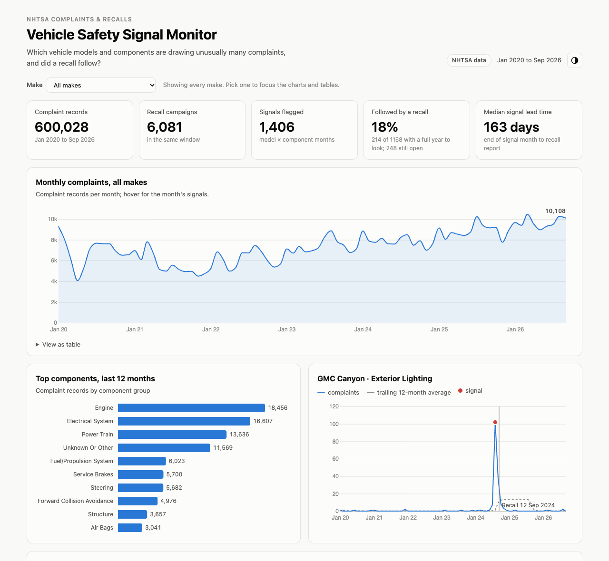
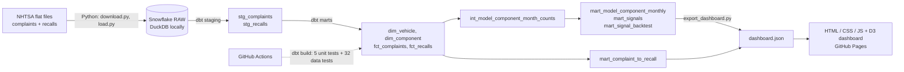

# Vehicle Safety Signal Monitor

An end-to-end analytics pipeline that turns NHTSA's public vehicle complaints into
**early-warning signals**: vehicle models whose complaints about one component jump well above
their own history. It then checks whether a recall followed, and **backtests whether the
signals beat chance**.

This is the same problem a post-market quality team solves: spot an emerging defect from
field data before it becomes a recall.

**Live dashboard:** *add the GitHub Pages link here after the first deploy* ·
**Model lineage:** the same link + `/lineage/`


*NHTSA complaints received January 2020 to September 2026 (vehicles only), and the recalls filed in the same window.*

## Architecture



| Layer | Tools | What it does |
|---|---|---|
| Ingestion | Python, pandas | Downloads NHTSA's period files (~200 MB zipped), checks the column count, drops personal fields, filters to `START_YEAR`, loads text columns into `raw` (re-runnable full refresh) |
| Warehouse | DuckDB (local and CI); Snowflake profile ready | Same dbt models; one macro handles each engine's date syntax. The Snowflake target hasn't been run yet |
| Transformation | dbt Core | Staging (typing, trimming, de-duplication), a star schema with an incremental complaints fact, an intermediate monthly grid, and analytical marts |
| Data quality | dbt tests, `profile_data.py` | 5 unit tests pin the signal rules on hand-made inputs; 32 data tests cover keys, relationships, plausible values and backtest consistency; source freshness runs in the monthly refresh |
| CI/CD | GitHub Actions | Builds and tests the whole pipeline on synthetic data on every push; publishes the dashboard and the dbt docs to GitHub Pages from `main` |
| Dashboard | HTML, CSS, JavaScript, D3 | Make filter, trend, top components, signal drill-down against baseline, **backtest of the method**, signal and recall tables; light and dark mode; works on phones |

## How a signal is defined

For every make × model × component group × month (for example *Chrysler · Pacifica · Steering ·
Sep 2025*), the model compares complaints with the **trailing 12-month average** (excluding the
current month). A month is flagged when all of these hold:

- complaints ≥ **2×** the baseline
- complaints ≥ **10**, so tiny counts can't trigger it
- at least **6 months** of history
- a Poisson z-score, (complaints − baseline) / √baseline, of **3 or more**
- **no recall** on the same model and component in the 90 days up to the end of the month.
  Complaints that follow a recall are owners reacting to it, not an early warning.

A signal counts as **followed by a recall** only if a recall on the same make, model and
component is filed *after the signal month ends* and within 365 days. Lead time is measured from
the first day of the next month, when the month's data is complete.

Every threshold is a variable in `dbt/dbt_project.yml`. `mart_signal_backtest` scores a grid of
them against the **base rate**: how often a recall follows any eligible month (enough history and
volume, no recent recall).

## Findings

From 600,028 NHTSA vehicle complaint records received January 2020 to September 2026, with the
default thresholds: 1,406 signals, 1,158 of them with a full year of follow-up.

1. **Complaint spikes alone barely predict recalls.** 18.5% of signals were followed by a recall
   on the same model and component within a year, against 17.5% of all eligible months: a lift
   of **1.05×**. Stricter thresholds help a little (z ≥ 5 reaches 1.18×), but those were picked on
   the same data, so treat them as a hint rather than a result. Matching at make level first, the
   rule did no better than chance (0.98×). Models like Ford Power Train get about 11 recalls a
   year, so "a recall followed" was nearly certain either way. Moving to model level made the
   outcome specific enough to measure.
2. **Where recalls are common, a spike does raise the odds.** Among the fifth of models and
   components most often recalled, 81% of signal months were followed by a recall, against 63%
   of their other months. For the rest, recalls are rare and spikes don't change that. Part of
   the reason: 92.5% of vehicle recalls since 2020 were initiated by the manufacturer, working
   from its own warranty and field data; only 6.7% were influenced by NHTSA's defects office,
   which is where public complaints feed in (`INFLUENCED_BY` in the recalls file).
3. **The strongest signals without a recall are worth reading.** Tesla Model 3 and Model Y
   brakes in February 2022 (113 and 84 complaints against baselines of 2.4 and 1.5) are owners
   describing "phantom braking" on adaptive cruise control. Chrysler Pacifica steering in
   September 2025 (81 against 3.0) is mostly 2017–2018 vehicles and stayed elevated afterwards.
   Neither had a matching recall within a year. See [docs/case-studies.md](docs/case-studies.md).

So the dashboard is a triage list for investigators, not a recall forecast: it points at models
where owners suddenly describe the same problem, and the narratives decide what's real.

Data-quality notes from profiling are in `reports/data_quality.md`.

## Run it

### 1. Local, with synthetic data (5 minutes)

```bash
python -m venv .venv && source .venv/bin/activate
pip install -r requirements.txt
make all       # sample data -> profile -> load to DuckDB -> dbt build -> export
               # (overwrites dashboard.json with sample data; `make real` restores it)
make serve     # open http://localhost:8000
make docs      # dbt docs and lineage graph at http://localhost:8080
```

### 2. Local, with the real NHTSA files (about 5 minutes)

```bash
make real      # download (~200 MB) -> profile -> load -> dbt build -> export
make serve
```

This uses NHTSA's `COMPLAINTS_RECEIVED_2020-2024.zip`, `COMPLAINTS_RECEIVED_2025-2026.zip` and
`FLAT_RCL_POST_2010.zip`, not the multi-GB `FLAT_CMPL.zip`. Unzipped, they take about 1.2 GB in
`data/`. If the project sits in an iCloud-synced folder (such as Desktop on a Mac), make `data/` a
symlink to a folder outside it, or iCloud will try to upload the files and stall reads while it
does. `RAW_DIR` and `DUCKDB_PATH` override the locations.

NHTSA adds fields from time to time (in 2025 it added two to complaints and two to recalls). If
the loader stops with a column-count message, compare NHTSA's field descriptions
([CMPL.txt](https://static.nhtsa.gov/odi/ffdd/cmpl/CMPL.txt), [RCL.txt](https://static.nhtsa.gov/odi/ffdd/rcl/RCL.txt))
with `ingestion/schema.yml`. The complaint field `VEHICLE_OPERATOR` holds a person's name and is
dropped before loading.

`fct_complaints` is incremental: a normal `dbt build` rebuilds only recent complaints. After
changing its logic, run `dbt build --full-refresh`.

### 3. Snowflake

1. Start a Snowflake trial, then create a database (for example `VEHICLE_SIGNALS`) and a warehouse.
2. Copy `.env.example` to `.env`, fill it in, and run `set -a; source .env; set +a`.
3. Run `cd ingestion && python load.py`, then `cd ../dbt && dbt build --profiles-dir . --target prod`, then `python scripts/export_dashboard.py`.
4. For a monthly automated refresh, add the same values as repository secrets.
   `.github/workflows/refresh.yml` then downloads, loads, checks source freshness, rebuilds,
   commits the new `dashboard.json` and starts CI to republish.

### 4. Publish the dashboard

Push to GitHub, enable **Settings → Pages → Source: GitHub Actions**, and the CI workflow
publishes the `dashboard/` folder with the dbt docs at `/lineage/`. The committed
`dashboard.json` is the real NHTSA export. CI rebuilds and tests on the sample but doesn't
overwrite it.

## Limitations

- Complaint counts aren't normalised by the number of vehicles on the road, so a popular model
  draws more complaints simply by volume. The baseline compares each model and component with
  its own history, which partly offsets this.
- The outcome is a recall on the same make, model and component group. A recall filed under a
  different component group, or under a differently spelled model name, isn't matched; 78% of
  recall campaigns by make and model match a model that has complaints.
- A signal can lead to an investigation or a service bulletin instead of a recall. Those aren't
  loaded, so the hit rate undercounts useful signals.
- Recent signals haven't had a full year to be followed by a recall. The recall rate and the
  backtest count only signals with a full 365 days after them.
- Only vehicles are counted (tires, child seats and equipment are dropped), the month still in
  progress is left out, and the catch-all "Unknown or other" component is never flagged.
- Real complaint counts are overdispersed (more variable than Poisson), so expect some false
  positives. The backtest shows how the thresholds trade volume for hit rate.
- `days_first_complaint_to_recall` is a lower bound, because complaints before `START_YEAR`
  aren't loaded.
- The Snowflake SQL avoids engine-specific features, but it has only been executed on DuckDB.
  Treat the first `--target prod` run as the test.

## Repository layout

```
ingestion/      download.py, load.py, sample_data.py, profile_data.py, schema.yml
dbt/            models/staging, models/intermediate, models/marts, macros, tests, profiles.yml
scripts/        export_dashboard.py
dashboard/      index.html, styles.css, app.js, data/dashboard.json
docs/           case-studies.md, INTERVIEW_NOTES.md, dashboard.png
reports/        data_quality.md
.github/        ci.yml (test + Pages + dbt docs), refresh.yml (monthly Snowflake refresh)
```

Data: [NHTSA datasets and APIs](https://www.nhtsa.gov/nhtsa-datasets-and-apis), public domain U.S. government data.
